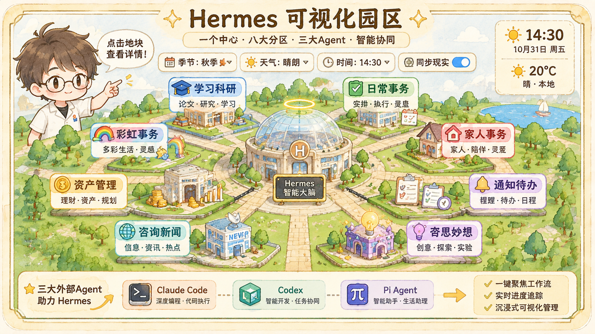

<figure class="project-cover" style="margin:0 0 1.5em;">
  
</figure>

**Module:** Web Projects

A 3D campus that renders my whole agent system as one navigable scene. At the centre sits the **Hermes brain**; eight domain zones orbit it — learning & research, daily affairs, family, notifications & to-dos, side ideas, news, asset management, and Rainbow — and **Claude Code, Codex and Pi** each own an outlying plot, so the division of labour between the resident assistant and the external agents is visible at a glance.

Built in **Blender** and exported to **glTF**, rendered live with **three.js**: seasonal and weather change, day/night lighting, one-click focus on any workflow, and a live progress tracker. Zone status is read from the real local `state.db` rather than scripted animation, so the campus reflects what the system is actually doing. The scene follows a fixed specification (16×16 unit plots, a 25×25 central hall, unified conveyor geometry, ~250+ meshed props) so every new zone looks like it belongs to the same world.

<a class="btn" href="https://github.com/yys806/hermes-park">Repository</a>

**模块：** 网页项目

Hermes 可视化园区把我整套 agent 体系画成了一座可以漫游的 3D 园区。中央是「Hermes 智能大脑」，外围八个分区各占一块：**学习科研、日常事务、家人事务、通知待办、奇思妙想、咨询新闻、资产管理、彩虹事务**；园区外还有 **Claude Code、Codex、Pi** 三个外协 Agent 的独立地块——谁是常驻管家、谁是外协分工，一眼就能看出来。

场景在 **Blender** 里建模、导出 **glTF**，用 **three.js** 实时渲染：四季与天气会跟着变、昼夜灯光随时间走、任意工作流可以一键聚焦，进度条实时追踪。各分区的状态不是写死的演示动画，而是直接读取本机 `state.db` 的真实数据，所以园区里发生的事就是系统当下在做的事。整套场景遵守一份固定规范（16×16 功能地块、25×25 中央大厅、统一传送带尺寸、250+ 网格小件），保证后续新增分区也长得像同一个世界里的东西。

<a class="btn" href="https://github.com/yys806/hermes-park">代码仓库</a>

